# missionboard

[Español](README.md) · **English**

A family app for a shared tablet. Kids follow their **missions** (tasks, with
pictures and voice), earn **stars**, spend them in a **shop** and unlock
a **daily prize** with a spinning wheel. **Routines** guide the busy moments of the
day (getting ready for school, bedtime) with an alarm, a talking clock and music.
A **parents' zone**, behind a code, is where everything is set up.

The interface is in Spanish; the code, comments and tests are in English.

<p align="center">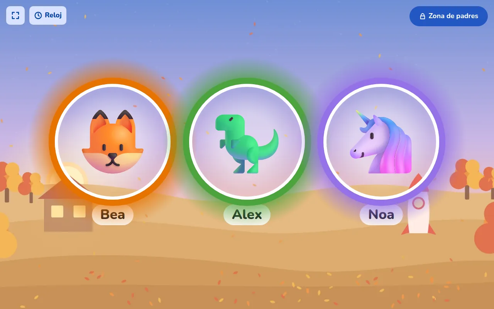</p>

## Features

- **Family missions:** a mission has tasks, and a task has reminders (what
  not to forget: teeth, face…). They are all
  everyone's, and each child has their own things switched on. A mission has its colour,
  days, hours and, if wanted, its routine.
- **Kids' screens:** each child is known by their avatar; their day is a route of
  missions, each one opened as a panel of cards: each task is a card ticked with one
  tap, with its reminders as small pictures. Stars, a celebration when a mission is done, and a daily prize when
  all of them are. The backgrounds follow the season and the moment of the day.
- **Routines:** they put time to a mission: its parts are the tasks, with their minutes,
  between an alarm and a goal. Either the start or the end time is pinned and the rest
  falls into place. The routine's hours count for its children; the others follow the
  mission's. On screen: a clock with each part's stretch, a voice that says what comes
  next, warnings before a part ends, a ten-second countdown, each kid with their
  mission, and music over chosen parts. Routines can ring at a time or be started by
  hand.
- **My place:** tapping their avatar, each child goes into their own landscape: their
  house, the mailbox (news about their orders), the rocket's workshop, the observatory
  (a star for each one they keep, forming constellations) and the shop.
- **Shop and orders:** with their stars, a child places an order; a truck takes it away
  and "My orders" shows when it arrives. Parents set the day and mark it delivered.
- **Streaks:** each day with its missions done fills a fuel tank; with the week
  complete, the child loads the rocket in the workshop, takes off and flies to the moon
  for the week's prize.
- **Parents' zone:** a side menu and, as the main screen, **Today**: how the kids are
  doing, what is waiting to be given (prizes and orders) and each one's week. From the
  menu: children, missions, routines (with a trial mode that runs them faster and lets
  you set the kids' missions at will), stars, streaks, prizes, shop, appearance, your
  own avatars, the parents' code, an event log (CSV export) and **backups**.
- **Phone notifications** (with Home Assistant): each order reaches the parents' phones,
  with buttons to say when it will be handed over.
- **Natural voice:** sentences are spoken with [Piper](https://github.com/OHF-Voice/piper1-gpl)
  on the server and cached; the tablet's own voice is the fallback.
- **Works offline:** no external services at run time; fonts and images are bundled.

## Screenshots

| 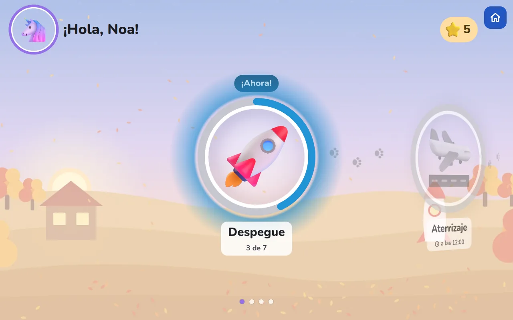 | 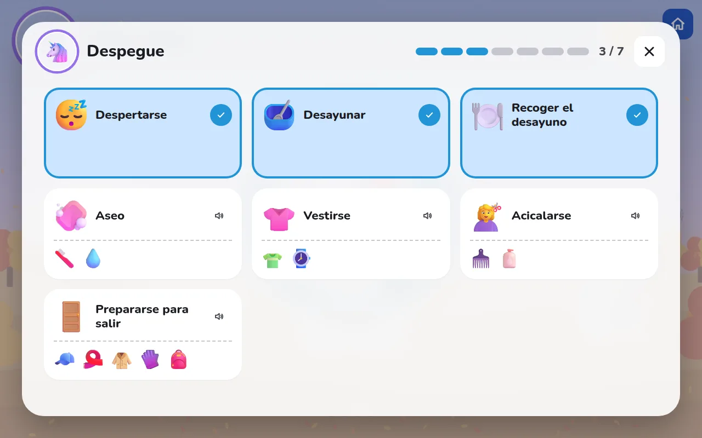 |
|:---:|:---:|
| A child's route: their missions on a wheel | A mission: each task ticked with one tap; reminders show what it includes |
| 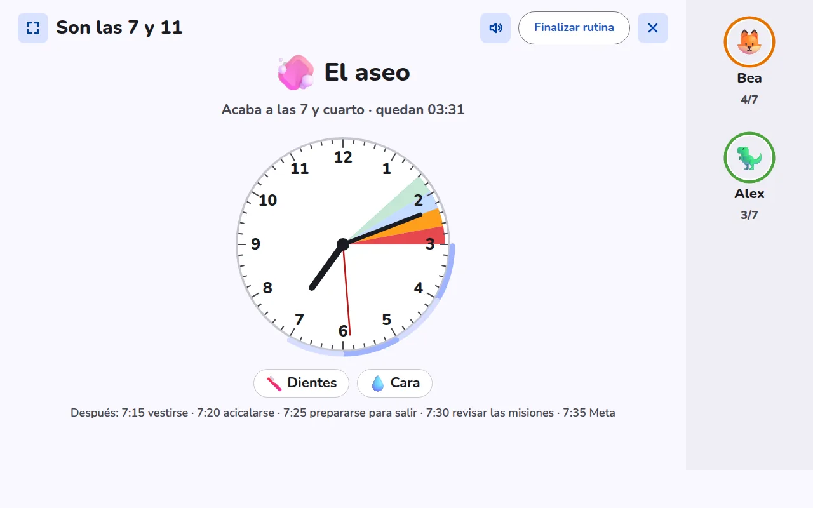 | 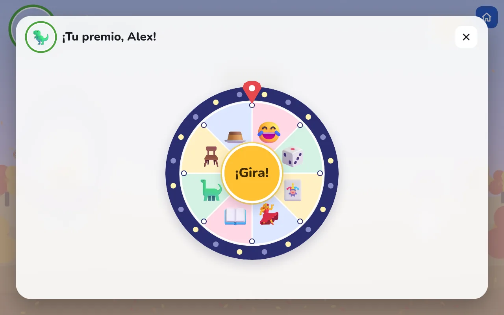 |
| A routine running: the clock, the part now and the kids | The daily prize: the wheel |
| 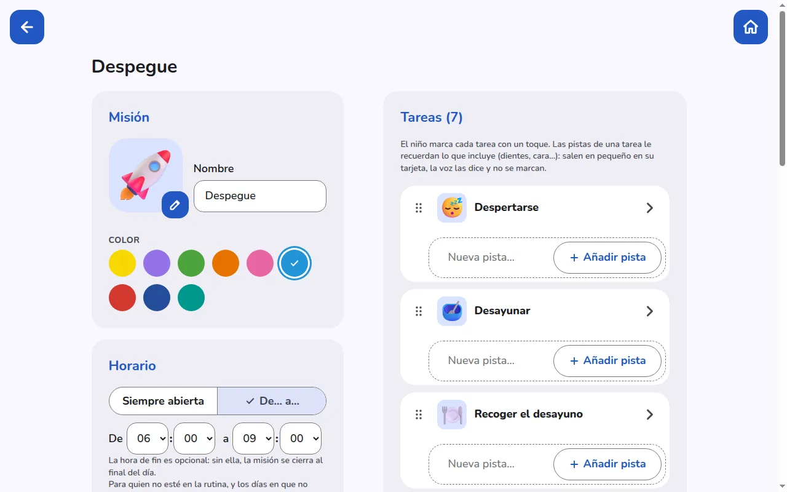 | 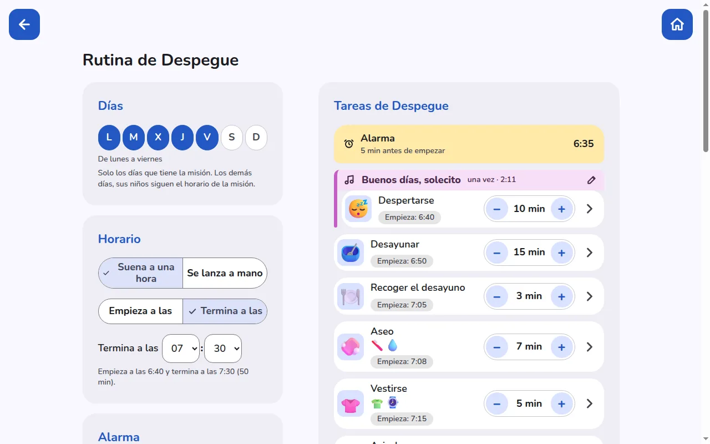 |
| Parents' zone: editing a mission | Parents' zone: editing a routine |
| 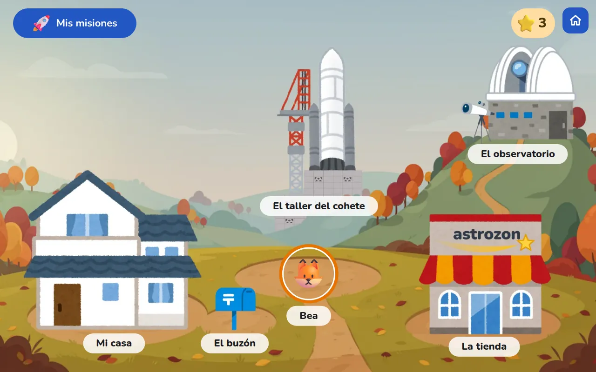 | 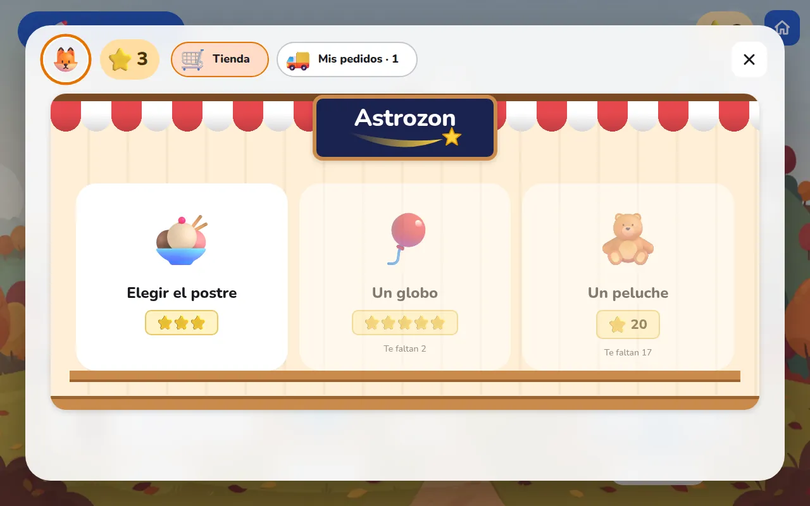 |
| My place: the child's landscape with its buildings | The shop: what they can order with their stars |
| 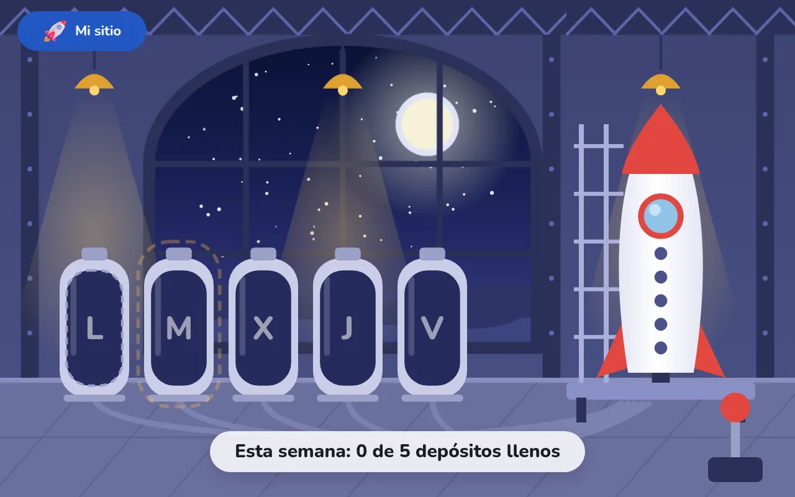 | 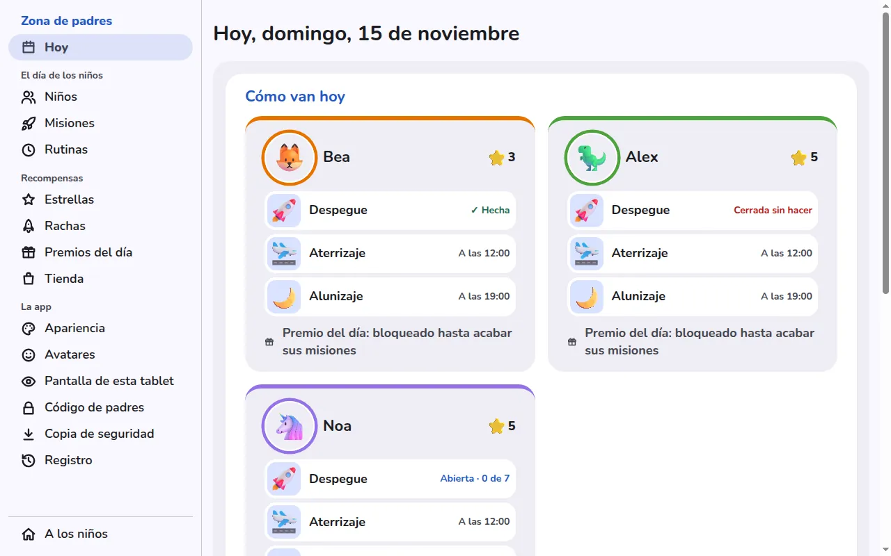 |
| The rocket's workshop: a fuel tank per day of the week | Parents' zone · Today: how the kids are doing |

## Quick start

Requirements: Python 3.12. With [uv](https://docs.astral.sh/uv/) (it downloads Python 3.12 if you don't have it):

```bash
uv venv --python 3.12 .venv && source .venv/bin/activate
uv pip install -r requirements.txt -r requirements-dev.txt
MISSIONBOARD_DATA_DIR=data uvicorn app.main:app --reload --host 0.0.0.0 --port 8002
```

Open <http://localhost:8002/>. The default parents' code is **1234**: change it in
*Zona de padres → Código de padres*. A new installation comes with three example children
(Bea, Alex and Noa) and three missions (Despegue, Aterrizaje and Alunizaje), with their
routines and two songs, to change as you like.

`bash dev.sh` does the same with the `.venv` environment (no need to activate it) and
prints the address to open from a tablet on the same network.

### The natural voice (optional)

Without a voice model the app uses the device's speech synthesis. To use Piper,
put [`es_ES-sharvard-medium.onnx`](https://huggingface.co/rhasspy/piper-voices/tree/main/es/es_ES/sharvard/medium)
and its `.onnx.json` in `data/voices/`, or point `MISSIONBOARD_VOICE_MODEL` at the
`.onnx` file. The Docker image downloads it on build.

## Docker

```bash
docker compose up -d --build
```

The app listens on port 8003 and keeps its data in `./data`.

## Data

Everything the family sets up and does lives in a data folder, never in the repository.
Its path comes from `MISSIONBOARD_DATA_DIR`: `data/` by default, `/srv/data` in the Docker
image (mounted from `./data`) and `/data` in the Home Assistant add-on (the persistent
storage Home Assistant gives each add-on).

| Path | What |
|---|---|
| `config.yaml` | Children, missions, routines, prizes, shop, settings and feature switches |
| `missionboard.db` | SQLite: the history (tasks ticked, missions done, stars, prizes, purchases, routines run, event log) |
| `photos/`, `sounds/` | Uploaded photos and songs |
| `voice-cache/` | Spoken sentences, generated again when missing |
| `backups/` | What there was before restoring a copy or starting from scratch |

The backgrounds are the app's (`app/static/backgrounds/`), one per season and moment of
the day; each season's dates and times are in `settings.seasons`.

- **Migrations** run on start-up; the previous file is kept next to it
  (`config.yaml.vN.bak`, `missionboard.db.vN.bak`). A file from a newer version stops
  the app instead of being changed.
- **Starting from scratch:** a `config.yaml` from before family missions is not
  converted: on start-up everything is copied to `backups/` and the app starts with the
  examples, keeping the song library. A backup from then cannot be restored.
- **Backups:** *Zona de padres → Copia de seguridad* downloads everything in one `.zip`
  (configuration, history, photos, songs) and restores such a file,
  checking it first and keeping what there was in `backups/`. It is the way to move
  a family to another device.
- `settings` and `features` in `config.yaml` can be edited by hand. On start-up the app
  writes the missing ones with their defaults, so they are all in sight; the ones there
  are left alone, also by updates. Invalid values stop the app at start-up with a
  message. Among them, the seasons (`seasons`: start, sunrise and sunset) and the margin
  of the morning and the evening around those times (`moment_margin_minutes`).

## Tests

```bash
pytest
```

Tests go through the HTTP API and the services. One of them fails if a colour is
written outside `app/static/css/tokens.css`.

## Project layout

```
app/
  main.py                 the FastAPI app: routers, shared state, start-up checks
  <feature>/              children, missions, today, routines, prizes,
                          shop, songs, events, backup, voice…
    api.py                routes: HTTP and validation
    service.py            rules, plain Python
    repository.py         reading and writing YAML or SQLite
  samples.py              the examples of a new installation
  storage/                config.yaml store and migrations, SQLite and migrations, starting from scratch
  static/                 the front end: HTML, CSS and JavaScript modules, no build step
    css/tokens.css        every colour, size and timing (themes/ holds Material colour roles)
    js/screens/           one module per screen
themes/                   Material Theme Builder exports
tools/                    theme, image-library and background generators
tests/
```

Back end: FastAPI, PyYAML, SQLite. Front end: plain HTML, CSS and JavaScript modules,
without frameworks or bundlers.

## Third-party assets

| | Licence |
|---|---|
| [Fluent Emoji](https://github.com/microsoft/fluentui-emoji) (`app/static/libraries/fluent/`) | MIT, see `LICENSE-fluent-emoji.txt` |
| Spanish keywords from [Unicode CLDR](https://cldr.unicode.org/) | Unicode License, see `LICENSE-unicode-cldr.txt` |
| [Nunito](https://fonts.google.com/specimen/Nunito) (`app/static/fonts/nunito/`) | SIL Open Font License, see `OFL.txt` |
| [Piper](https://github.com/OHF-Voice/piper1-gpl) (`piper-tts`, installed with pip) | See its repository |
| Voice model `es_ES-sharvard-medium` (downloaded, not in the repository) | See its [model card](https://huggingface.co/rhasspy/piper-voices/tree/main/es/es_ES/sharvard/medium) |

The example songs (`app/samples_sounds/`: «Buenos días, solecito» and «Duerme,
Estrellita») are published with the repository, under its MIT licence.

Drawn for this project, under the repository's MIT licence: the pyjamas
(`app/static/libraries/own/`) and the backgrounds (`app/static/backgrounds/`, with their
programs in `tools/fondos/`, which need Pillow).

## Licence

[MIT](LICENSE). The third-party assets in the table above keep their own licences.
